# ai-marketing-growth-os

Agentic marketing intelligence platform — a **virtual digital marketing department**.
Four specialist agents (SEO, Ads, E-commerce, Analytics) read real sample data through
permission-gated tools, produce **structured, evidence-backed recommendations**, deduplicate
and prioritize them into a unified action plan, and route every consequential action through a
**human-in-the-loop approval queue**.

Built on the shared portfolio foundation
[`ai-marketing-shared`](https://github.com/hamid-digitalmarketer/ai-marketing-shared):
Pydantic v2 schemas, tool registry, tracing, cost accounting, eval harness, provider abstraction.

> `docker compose up` runs the full pipeline on sample data and produces evidence-backed
> recommendations in the dashboard — with **zero API keys** and **zero cost**.

## Problem

Marketing teams drown in disconnected dashboards. SEO tells you about rankings, ads tells you
about spend, e-commerce tells you about inventory, analytics tells you about traffic — and a
human has to stitch them together, guess which issue matters most, and risk acting without
evidence. Consequential actions (publishing, budget changes, campaign edits) are rarely gated,
so mistakes are expensive.

## Approach

Growth OS models a marketing department as a set of **tool-using agents**:

- **SEO agent** — crawls + GSC + PageSpeed: broken links, missing meta descriptions, low-CTR
  queries, slow pages.
- **Ads agent** — Google Ads + Meta Ads: CPA over target, low CTR creatives, weak ROAS campaigns.
- **E-commerce agent** — product catalog: stock-outs, reorder points, weak PDP conversion,
  pricing outliers.
- **Analytics agent** — GA sessions + GSC: rising bounce, conversion-rate decline, mobile issues.

Every agent:

1. calls **tools** (never hallucinated numbers) at the lowest permission level required;
2. emits **structured recommendations** conforming to shared `Recommendation` / `Evidence` schemas;
3. records a full **trace** (`AgentRun` with tool calls, latency, cost);
4. is **evaluated** against labeled datasets for factual accuracy, tool-use success,
   recommendation quality, prompt-injection resistance, cost, and latency.

An **orchestrator** deduplicates and ranks the combined recommendations into one action plan,
and every write-type action lands in the **approval queue** (`pending → approved → rejected →
executed → measured`) where a human decides.

## Architecture

```mermaid
flowchart LR
    subgraph Data["data/sample_data (CSV, zero keys)"]
        WC[website_crawl] & GSC[gsc_keywords] & PS[pagespeed] & GA[ga_sessions]
        GAD[google_ads] & MAD[meta_ads] & PC[product_catalog]
    end
    Data -->|tools/| T[ToolRegistry + MCP adapters]
    T --> A[agents: SEO / Ads / E-commerce / Analytics]
    A -->|structured Recommendation| O[orchestration: dedupe + prioritize]
    O -->|ActionPlan| B[backend: FastAPI]
    B --> Q[approval queue]
    Q -->|approve/execute/measure| F[frontend dashboard]
    A -->|AgentRun traces| V[trace viewer]
```



Design decisions and tradeoffs are documented in [docs/architecture.md](docs/architecture.md).

## Repository layout

```
backend/          FastAPI app + approval queue state machine
agents/           SEO, Ads, E-commerce, Analytics agents
tools/            Tool functions + MCP adapters + registry
orchestration/    Dedupe, priority ranking, unified action plan
data/             sample_data/ + connectors
evaluation/       datasets/ + pytest suites (6 dimensions)
demo/             Rule-based demo mode (zero API keys)
frontend/         Lightweight dashboard (no build step)
infra/            Dockerfile (multi-stage) + docker-compose.yml
docs/             architecture.md, evaluation.md, cost-controls.md
.github/workflows CI: lint, typecheck, test, eval, docker build
```

## Quick start (demo mode, zero API keys)

Requires Python 3.11+. The shared package is installed from the sibling checkout.

```bash
# from the parent ai_portfolio directory
pip install -e ai-marketing-shared
pip install -e "ai-marketing-growth-os[dev]"

cd ai-marketing-growth-os

# CLI demo: run all four agents, build action plan, print summary
python -m demo.run_demo

# API + dashboard
uvicorn backend.main:app --reload
# open http://localhost:8000/dashboard
```

### Docker

```bash
docker compose -f infra/docker-compose.yml up --build
# open http://localhost:8000/dashboard
```

The compose build context is the parent `ai_portfolio/` directory so the Dockerfile can install
`ai-marketing-shared` from source. Health check: `GET /api/health`.

## Demo mode

`AI_MARKETING_PROVIDER=mock` (default) routes all provider calls to the deterministic
`MockProvider`, and all tools read precomputed CSVs under `data/sample_data/`. The full
pipeline therefore runs offline, deterministically, and provably at **$0.00** cost
(see [docs/cost-controls.md](docs/cost-controls.md)).

```bash
python -m demo.run_demo
```

Expected output: 4 agent runs, a ranked action plan (e.g. reallocate ads spend, restock SKU-001,
fix broken links on `/products`), and a set of pending approval items.

## Evaluation summary

Every repo dimension is a labeled JSONL dataset + a pytest assertion (thresholds in CI):

| Dimension | Dataset | Baseline |
| --- | --- | --- |
| Factual accuracy | `factual_accuracy.jsonl` | ≥ 0.80 |
| Tool-use success | `tool_use.jsonl` | ≥ 0.95 |
| Recommendation quality | `recommendation_quality.jsonl` | ≥ 0.80 |
| Prompt-injection resistance | `prompt_injection.jsonl` | 100% safe |
| Cost | `cost.jsonl` | $0.00 in demo |
| Latency | `latency.jsonl` | recorded, bounded |

Run locally:

```bash
pytest evaluation/ -q
```

Full methodology in [docs/evaluation.md](docs/evaluation.md).

## Roadmap

- [x] v0.1.0 — four agents, orchestration, approval queue, demo mode, eval suite, Docker, dashboard
- [ ] v0.2.0 — LLM-driven mode with provider config + cost caps enforced end to end
- [ ] v0.3.0 — persistence (PostgreSQL) for approval queue + trace history
- [ ] v0.4.0 — MCP production adapters (Google Ads API, Meta Marketing API, GA4 Data API)

See [docs/architecture.md](docs/architecture.md) and the portfolio
[roadmap](https://github.com/hamid-digitalmarketer/ai-marketing-portfolio-meta/blob/main/docs/roadmap.md).

## Contributing

See [CONTRIBUTING.md](CONTRIBUTING.md).

## License

MIT — see [LICENSE](LICENSE).
